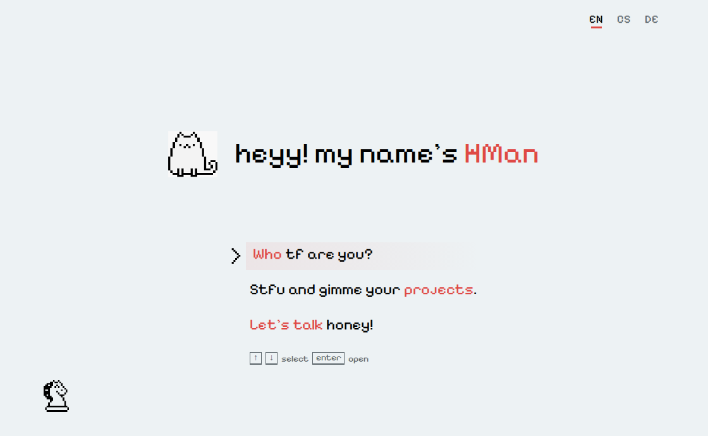

# HMan’s portfolio

My little corner of the web for software, graphics, hardware, and the occasional cat break. I designed it in Figma around a game menu. Pick a line with the cursor and hit <kbd>Enter</kbd> to explore.



[Instagram](https://www.instagram.com/h.pilot.fpv/) · [Telegram](https://t.me/hmandev) · [GitHub](https://github.com/HMan4256) · [Buy Me a Coffee](https://buymeacoffee.com/hman)

## Inside the menu

| Screen | What you’ll find |
| --- | --- |
| **Who tf are you?** | The things I make, from web apps to PCB design. Run the cursor over Software, Graphics, and Hardware to try each text effect. |
| **Stfu and gimme your projects.** | The four public repos I’ve pushed to most recently. The site refreshes GitHub data every 15 minutes and shows a handpicked selection when GitHub is unavailable. |
| **Let’s talk honey!** | The places to reach me, see what I’m up to, or buy me a coffee. |

Move with <kbd>↑</kbd> and <kbd>↓</kbd>, hover and click, or tap on mobile. Pixel wipes connect the screens. Click the cat for hearts.

## Run it locally

Use Node.js 20.9 or newer and npm. From the repo root, run

```sh
npm ci
npm run dev
```

Open [localhost:3000](http://localhost:3000). For a production build, run `npm run build` followed by `npm start`. Use `npm run typecheck` to check TypeScript.

To use any of these optional settings, copy `.env.example` to `.env.local`.

| Variable | What it does |
| --- | --- |
| `CONTACT_EMAIL` | Adds a public email link to the contact screen. |
| `GITHUB_TOKEN` | Authenticates the server’s GitHub requests for a higher API rate limit. |
| `SITE_URL` | Overrides the canonical public origin for metadata and the sitemap. Defaults to `https://www.fancyweb.top`. |
| `GOOGLE_SITE_VERIFICATION` | Adds the HTML verification token from Google Search Console. |

## English · Čeština · Deutsch

The language switcher works on every screen. Pick a language and the text decodes from ASCII into the new copy. Visitors who prefer reduced motion see the translation immediately.

Every page has an English, Czech, and German URL under `/en`, `/cs`, and `/de`. Opening a URL without a language prefix uses the saved choice, then the country header from Cloudflare or Vercel, then the browser’s language, with English as the fallback. The switcher saves its choice for a year.

The deployed `/sitemap.xml` lists the canonical pages and their translations. It’s linked from `/robots.txt` and can be submitted to Google Search Console.

## Under the hood

Built with Next.js App Router, React, TypeScript, Tailwind CSS, and GSAP.

| To change | Start here |
| --- | --- |
| Page content and layout | [app/](app/) |
| Language copy | [translations.ts](lib/translations.ts) |
| Page wipes and ASCII text | [page-motion.tsx](components/page-motion.tsx) · [decode-text.tsx](components/decode-text.tsx) |
| GitHub account and featured repos | [profile.ts](lib/profile.ts) · [repositories.ts](lib/repositories.ts) |

The cat and menu sprites come from my Figma design. The interface uses Pixelarticons and Pixelify Sans. [Pixelarticons license](components/Pixelarticons-LICENSE.txt) · [Pixelify Sans license](app/PixelifySans-OFL.txt)
